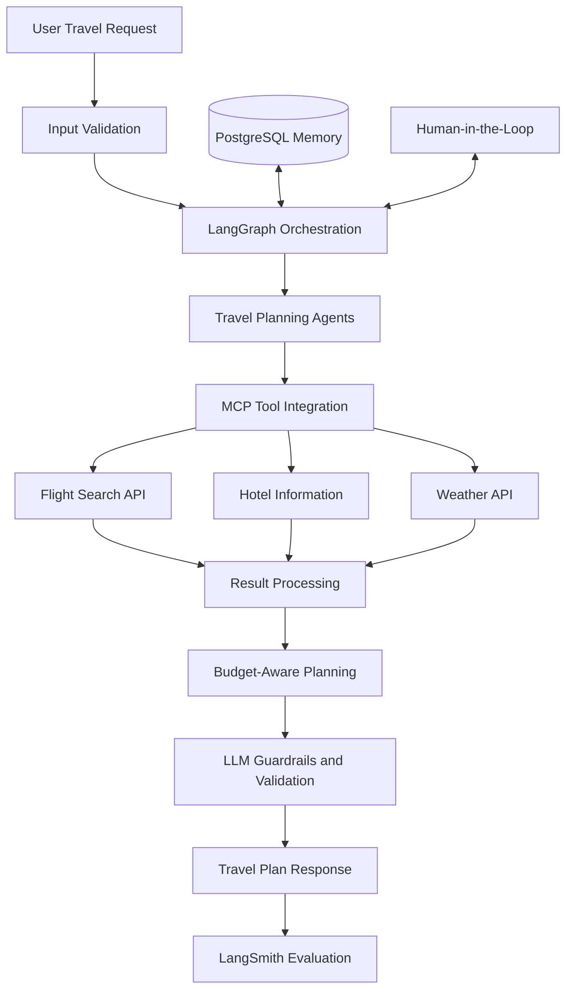

# ✈️ Agentic AI Travel Planner & Flight Booker (End-To-End)
An AI-powered, budget-aware travel planning application that helps users plan trips by coordinating flight searches, hotel options, weather information, and budget constraints through a multi-agent architecture.

🔗 **Live Demo:** [Try the Application](https://agentic-ai-project-flight-booker-2-8v2r.onrender.com/)

📂 **GitHub Repository:** [Agentic AI Project — Flight Booker](https://github.com/TusharK93/Agentic-AI-Project---Flight-Booker)

---

## 📌 Project Overview

Planning a trip often requires hours of research across multiple websites to compare flights, find hotels, check weather conditions, and stay within a budget.

The **Agentic AI Travel Planner & Flight Booker** addresses this challenge through an intelligent, agent-based workflow that coordinates travel-related tasks and helps users make budget-conscious travel decisions.

Built using **LangGraph, LangChain, Model Context Protocol (MCP), and LLM-powered agents**, the application combines tool calling, structured outputs, persistent memory, human oversight, and evaluation to create a more reliable travel-planning experience.

## 🎯 Problem Statement

Traditional travel planning involves several challenges:

- Searching multiple platforms for flight and hotel options.
- Checking destination weather and travel conditions separately.
- Managing trip expenses and budget constraints.
- Coordinating multiple tasks manually.
- Dealing with inaccurate LLM responses and unreliable tool selection.

## 💡 Solution

The project implements an end-to-end AI travel-planning workflow that combines multiple specialized agents with external tools and structured orchestration.

### Key capabilities

- **Multi-Agent Architecture:** Coordinates specialized agents to handle different travel-planning tasks.
- **Budget-Aware Planning:** Considers budget constraints when generating travel recommendations.
- **Flight Search:** Integrates live travel APIs to retrieve flight-related information.
- **Hotel Research:** Supports hotel-related information gathering as part of the planning workflow.
- **Weather Information:** Incorporates destination weather data into travel planning.
- **MCP Tool Calling:** Uses the Model Context Protocol to connect AI workflows with external tools.
- **Human-in-the-Loop (HITL):** Supports human oversight in the workflow where required.
- **Persistent Memory:** Uses PostgreSQL-based memory to retain relevant information across supported interactions.
- **Structured Outputs:** Uses Pydantic for data validation and consistent data structures.
- **LLM Guardrails:** Adds controls to improve the reliability of model outputs and tool interactions.
- **Error Handling & Logging:** Uses centralized configuration, structured logging, and error-handling mechanisms.
- **LLM Evaluation:** Uses LangSmith to evaluate model behavior, including faithfulness, hallucination detection, and tool-selection accuracy.

## 🏗️ Architecture & Workflow

The application follows an agentic workflow in which the LLM coordinates tasks, selects tools, and processes their results.



*Note: This diagram illustrates the high-level workflow. The exact agent structure and execution path depend on the implementation.*

## 🛠️ Technology Stack

| Technology | Purpose |
|---|---|
| Python | Core application development |
| Streamlit | User interface |
| LangChain | LLM integration and tool orchestration |
| LangGraph | Agent workflow orchestration |
| Model Context Protocol (MCP) | Integration with external tools |
| Pydantic | Structured data validation |
| PostgreSQL | Persistent memory |
| LangSmith | Tracing, evaluation, and LLM quality analysis |
| LLM Gateway | Centralized model access and integration |
| Docker | Application containerization |
| Render | Cloud deployment |
| Travel APIs | Live travel-related data integration |

## 📊 Performance & Results

The project was evaluated with **3 users** to assess workflow effectiveness, tool usage, and budget adherence.

| Metric | Result |
|---|---:|
| Task Success Rate | 90% |
| Tool Accuracy | 92% |
| Budget Compliance | 85% |
| Average Latency | 14 seconds |
| User Validation | 3 users |

### Evaluation focus

- **Task Success:** Whether the workflow successfully completed the requested travel-planning tasks.
- **Tool Accuracy:** Whether the system selected and used the appropriate tools.
- **Budget Compliance:** Whether the generated plans respected the specified budget constraints.
- **Faithfulness:** Whether responses remained consistent with the available information.
- **Hallucination Detection:** Whether unsupported or fabricated information could be identified.
- **Latency:** The average time taken to produce a result.

*These figures represent the project's reported evaluation results and should be interpreted in the context of the test setup and sample size.*

## 🚀 Live Deployment

The application is containerized using Docker and deployed on Render.

- **Live Application:** https://agentic-ai-project-flight-booker-2-8v2r.onrender.com/
- **Source Code:** https://github.com/TusharK93/Agentic-AI-Project---Flight-Booker

The deployed proof of concept integrates with live travel APIs to support travel-related information retrieval.

## ⚙️ Getting Started

Follow these steps to run the project locally.

### Prerequisites

Make sure you have the following installed:

- Python 3.10+ (use the version specified by the project if different)
- Git
- Docker (optional, for containerized execution)
- PostgreSQL, if required by the configured memory backend
- API credentials for the external services and LLM provider used by the project

### 1. Clone the repository

```bash
git clone https://github.com/TusharK93/Agentic-AI-Project---Flight-Booker.git
cd Agentic-AI-Project---Flight-Booker
```

### 2. Create a virtual environment

```bash
python -m venv .venv
```

Activate it:

**Windows**

```bash
.venv\Scripts\activate
```

**macOS / Linux**

```bash
source .venv/bin/activate
```

### 3. Install dependencies

If the repository contains a `requirements.txt` file:

```bash
pip install -r requirements.txt
```

If the project uses `pyproject.toml`, Poetry, or another dependency manager, follow the instructions provided by that configuration.

### 4. Configure environment variables

Create a `.env` file in the project root and configure the credentials required by your implementation.

Example template:

```env
# LLM configuration
LLM_API_KEY=your_llm_api_key
LLM_MODEL=your_model_name

# Database configuration
DATABASE_URL=your_postgresql_connection_string

# Travel API configuration
FLIGHT_API_KEY=your_flight_api_key
HOTEL_API_KEY=your_hotel_api_key
WEATHER_API_KEY=your_weather_api_key

# Observability and evaluation
LANGSMITH_API_KEY=your_langsmith_api_key
LANGSMITH_TRACING=true
LANGSMITH_PROJECT=flight-booker
```

**Important:** These variable names are illustrative placeholders. Use the exact names expected by your application's configuration. Remove any variables for services that your implementation does not use.

Never commit API keys, database credentials, or other secrets to GitHub.

### 5. Run the application

For a Streamlit application, use:

```bash
streamlit run app.py
```

Replace `app.py` with the actual Streamlit entry-point filename if it differs.

The terminal will display a local URL, typically:

```text
http://localhost:8501
```

Open that URL in your browser to access the application.

## 🐳 Running with Docker

If the repository includes a `Dockerfile`, you can build and run the application using Docker.

### Build the image

```bash
docker build -t agentic-flight-booker .
```

### Run the container

```bash
docker run --env-file .env -p 8501:8501 agentic-flight-booker
```

Ensure the Docker configuration exposes the application's actual listening port and uses the correct startup command.

## 📈 Observability & Evaluation

The project incorporates LLM observability and evaluation to improve the reliability of agentic workflows.

Using LangSmith and the project's evaluation pipeline, the system can be assessed for:

- Task completion and workflow success.
- Tool-selection accuracy.
- Faithfulness to retrieved information.
- Hallucination-related failures.
- Response latency and execution behavior.

These evaluations help identify failure cases and opportunities to improve the overall planning experience.

## 🔒 Reliability & Safety

The system incorporates several engineering practices to improve robustness:

- Centralized configuration management.
- Structured application logging.
- Error handling for workflow and tool failures.
- Pydantic-based input and output validation.
- LLM guardrails for more controlled responses.
- Human oversight for applicable workflow decisions.
- Evaluation and tracing to identify incorrect outputs and tool usage.

## 🔮 Future Enhancements

Potential improvements include:

- Flight and hotel price comparison across additional providers.
- Real-time price alerts and fare tracking.
- More advanced itinerary optimization.
- Currency conversion and detailed expense breakdowns.
- Personalized recommendations using long-term preferences.
- Improved memory management and conversation continuity.
- Broader evaluation datasets and automated regression testing.
- Expanded human approval workflows for booking-related actions.
- Production-grade monitoring, authentication, and deployment scalability.

## 👨‍💻 Author

**Tushar K**

- GitHub: [@TusharK93](https://github.com/TusharK93)

## 📄 License

No license has been specified here. If you intend to make the project open source, consider adding a `LICENSE` file and updating this section accordingly.

---

⭐ If you find this project interesting, consider starring the repository on GitHub!

**Built with LangGraph, LangChain, MCP, and agentic AI to make travel planning smarter and more budget-conscious.**
<p align="center">
  
</p>
